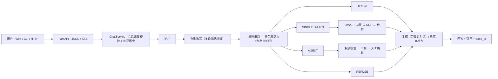

<h1 align="center">Adaptive RAG 电商客服 · 二次开发版</h1>

<p align="center">
基于开源项目 <a href="https://github.com/JEen-wang/Adaptive-rag">JEen-wang/Adaptive-rag</a>（MIT）二次开发：<br>
接入 DeepSeek V4.1 Flash，补齐多轮对话记忆，修复路由误判，并用无泄漏的评测重新量化效果。
</p>

<p align="center">FastAPI × LangGraph × 混合检索（BM25 + 向量 + RRF + Cross-Encoder）× 工具调用与人工确认</p>

<p align="center">
  <a href="https://github.com/lht030202/adaptive-rag-cs-agent/actions/workflows/ci.yml"></a>
  <a href="LICENSE"></a>
  
</p>

---

## 项目是什么

一套电商客服工作流。核心思路是**先判断，再分流**：请求先过安全护栏，再做意图识别和复杂度判断，然后在五条路径里选一条——

| 路径 | 适合的问题 | 处理方式 |
|:---:|:---|:---|
| `DIRECT` | 问候、闲聊 | 直接生成，不检索 |
| `SINGLE` | 单一政策问题 | 一轮混合检索 + 精排 |
| `MULTI` | 多条件、跨条款问题 | 查询改写 + 多跳检索 + 自纠错（Self-RAG） |
| `AGENT` | 查订单、物流、发起售后操作 | 规划后调用工具；写操作先返回待确认动作 |
| `REFUSE` | 越界、注入 | 拒答或引导人工 |

原项目已经实现了上面这套流程（LangGraph 状态机、15 个业务工具、HITL 人工确认与幂等、降级、CI）。

## 我在原项目上做的改进

我跑通并评估原项目后发现了下面几个问题，逐一修复，并用评测量化效果。所有数字都是我自己在本仓库里跑出来的（见[实测结果](#results)）。

| 发现的问题 | 改动 | 效果（自测） |
|:---|:---|:---|
| **多轮对话不生效**：历史消息和摘要从未进入任何一次模型调用，"那帮我把它取消掉"会被要求重新提供订单号 | 新增**查询改写节点**（指代消解）：用最近 3 轮对话把追问改写成可独立理解的问题，再交给意图、路由、检索和规划；回答生成也带上最近对话。同时补上**会话归属校验**，防止用别人的会话 ID 读到历史 | 22 段多轮对话的任务完成率 **45.5% → 95.5%**（10/22 → 21/22） |
| **路由误判**：模型偶尔把政策问题分到 `DIRECT`（不检索），例如"电子发票多久能开"直接回答"没有可用的政策依据" | 路由护栏：只有问候、闲聊允许跳过检索，其他意图被分到 `DIRECT` 时回退到规则路由 | 该类问题必定走检索（有单元测试覆盖） |
| **意图评测有泄漏**：原 100 条测试集上，覆盖层规则**不调模型就能 100%**，规则短语和提示词示例都是照着测试题写的 | 新写 98 条**独立测试集**（14 类 × 7 条，写规则和提示词时从未见过），分别测纯模型、模型 + 覆盖层 | 覆盖层在原测试集上 100%，在独立测试集上反降至 **88.8%**；纯模型 **96.9%**，据此默认关闭覆盖层 |
| **换模型后延迟高**：DeepSeek V4.1 Flash 默认开启思考模式，一个问题要连续调用多次模型 | 新增 `LLM_ENABLE_THINKING` 开关；不配置就不传参数，兼容其他服务商 | 端到端 P50 **8.7 s → 6.1 s**，P95 12.3 s → 8.8 s，质量指标不变 |
| **回答里夹带内部字段**：正文中出现 chunk_id、"未检索到可引用的证据片段"等提示词内容 | 调整回答提示词：引用只放在结构化字段里，正文面向用户 | — |

<a id="results"></a>

## 实测结果

测量日期 2026-11-08。生成模型：硅基流动上的 `deepseek-ai/DeepSeek-V4.1-Flash`；向量模型 `BAAI/bge-small-zh-v1.5`；精排 `BAAI/bge-reranker-base`（本地）。原始报告 JSON 在 `eval/reports/`（不入库），复现命令见下一节。

| 评测 | 数据 | 结果 |
|:---|:---|:---|
| 检索消融 | 65 条政策问题 / 39 篇文档 | P@1：BM25 **80.0%** → 混合检索 **83.1%** → 加精排 **89.2%**<br>Recall@3：90.0% → 94.6% → **96.2%**；MRR：0.856 → 0.892 → **0.932** |
| 意图识别 | 原 100 条 / 独立 98 条 | 纯模型：原 96.0% / 独立 **96.9%**<br>模型 + 覆盖层：原 100% / 独立 **88.8%**<br>覆盖层单独（独立集）：17.3%，98 条中 73 条无法覆盖 |
| 多轮对话 | 22 段对话（2～3 轮），只评最后一轮 | 关闭多轮记忆 **45.5%**（10/22）→ 开启 **95.5%**（21/22）：修好 11 段，没有退化 |
| 端到端 | 16 条 × 2 轮 = 32 次请求 | 思考开：P50 8.7 s / P95 12.3 s<br>思考关：P50 **6.1 s** / P95 **8.8 s**<br>关键词命中、拒答准确率、工具路径命中：两种配置下均为 100% |

> [!IMPORTANT]
> 这些是指定小规模离线集合上的测量值，不代表线上效果。测试集为单人编写和标注；延迟依赖硅基流动共享接口，不同时段会有波动；每组只跑了 1～2 轮。

## 快速开始

需要 Python 3.11+ 和 [uv](https://docs.astral.sh/uv/)。

```bash
uv sync --extra dev --extra rerank
cp .env.example .env    # 在 .env 里填入 DEEPSEEK_API_KEY（硅基流动的 key）
.venv/bin/uvicorn app.asgi:app --reload --port 8002
```

首次启动会下载本地向量模型和精排模型；下载完成后可以加上 `HF_HUB_OFFLINE=1` 只用本地缓存。打开 http://127.0.0.1:8002 即可对话（需先在 `frontend/` 下执行 `npm ci && npm run build`）。演示订单数据的写入方式见原项目说明 `docs/02-getting-started.md`。

## 复现评测

```bash
python -m eval.runner --task retrieval                  # 检索消融（不调用模型）
python -m eval.runner --task intent_heldout --llm       # 意图：原测试集 vs 独立测试集
python -m eval.runner --task multiturn                  # 多轮：关闭 / 开启多轮记忆
LLM_ENABLE_THINKING=true  python scripts/e2e_latency.py thinking_on
LLM_ENABLE_THINKING=false python scripts/e2e_latency.py thinking_off
```

## 架构



本版本新增或修改的代码：

| 文件 | 作用 |
|:---|:---|
| `app/agents/nodes/contextualize.py`、`app/memory/contextualize.py`、`app/prompts/contextualize.py` | 查询改写节点、改写器（模型改写 + 规则兜底）、改写提示词 |
| `app/memory/context.py` | 把最近几轮对话渲染成有长度上限的上下文块 |
| `app/services/chat_service.py` | 加载会话摘要、会话归属校验、响应里返回改写后的问题 |
| `app/retrieval/adaptive.py` | 路由护栏 |
| `app/providers/deepseek.py`、`app/config/settings.py` | 思考模式开关、多轮记忆开关 |
| `eval/runner.py`、`eval/dataset/intent_heldout.jsonl`、`eval/dataset/multiturn_eval.jsonl`、`scripts/e2e_latency.py` | 新增评测任务和数据集 |

## 已知局限

- 请求里的 `user_id` 没有经过认证，会话归属校验只能防止串用会话，不能替代登录鉴权。
- 待确认动作保存在进程内存中，服务重启会丢失，多副本部署时确认请求可能落到另一台实例。
- 流式接口是在答案生成并校验完成后再分段输出，不是逐 token 生成。
- "MCP" 部分是简化的 HTTP 工具适配，没有实现 MCP 协议本身。
- 会话摘要只在上下文用量超过预算 85% 时才会生成，日常对话主要依靠最近 3 轮原文。
- 规划器一次性生成计划后顺序执行，没有"观察工具结果再决定下一步"的循环。

## 致谢与许可证

本项目基于 [JEen-wang/Adaptive-rag](https://github.com/JEen-wang/Adaptive-rag) 二次开发，原项目的设计文档与教程保留在 `docs/` 下（描述的是原版行为，本版本的差异见上表）。遵循 [MIT License](LICENSE)，保留原作者版权声明。
